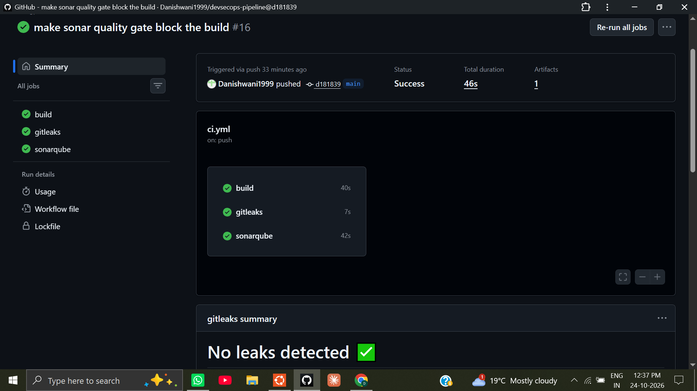
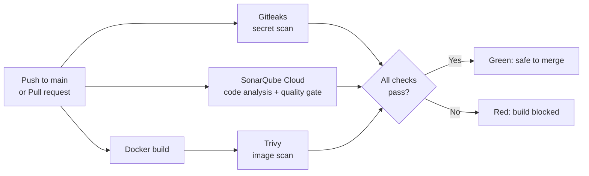
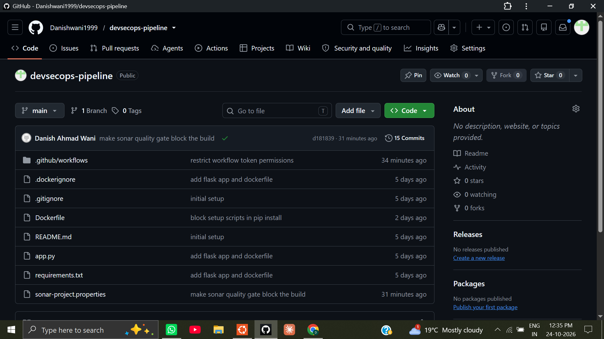
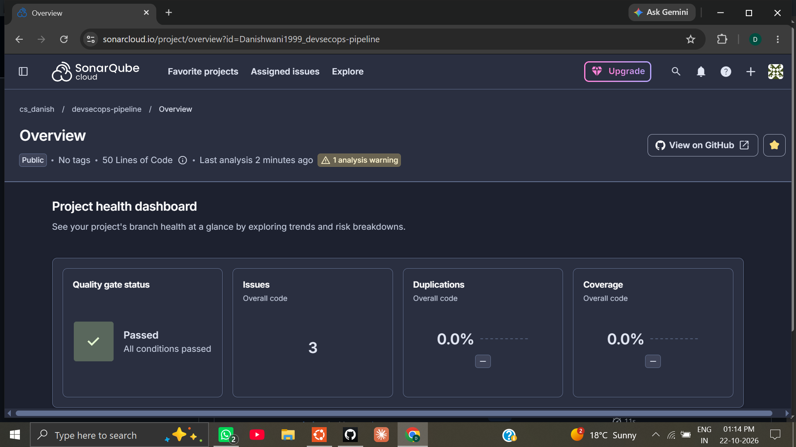
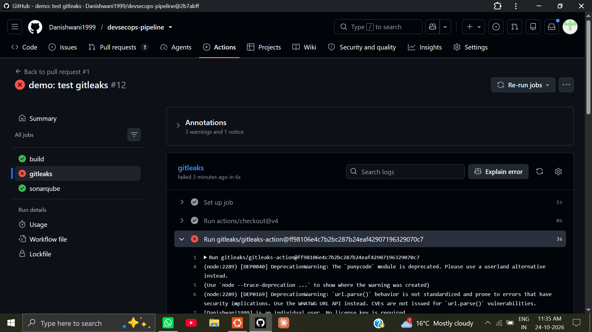
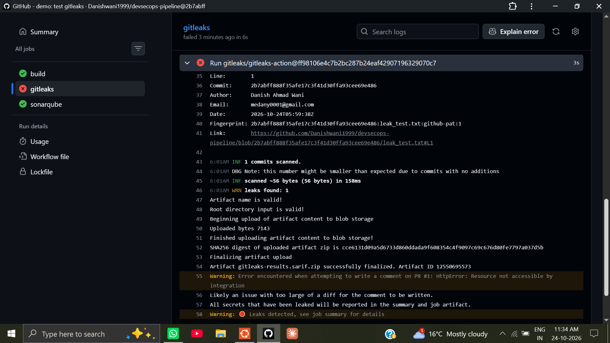
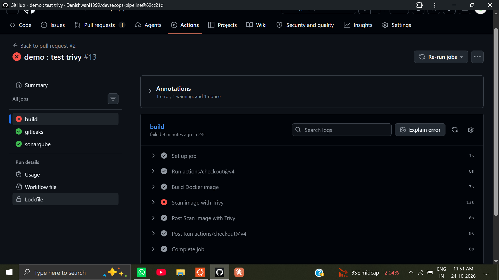
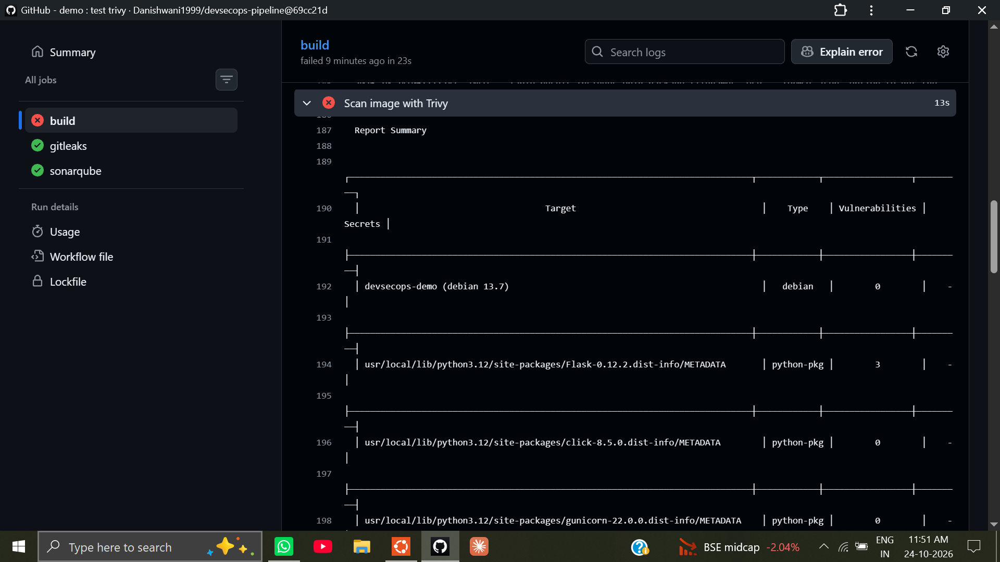
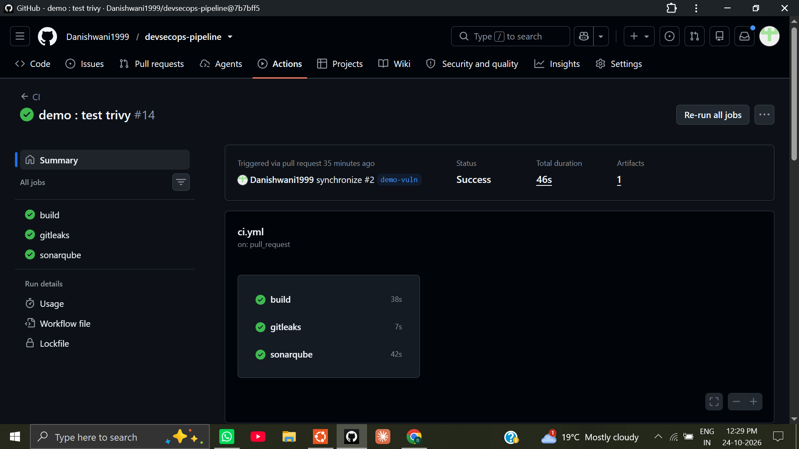
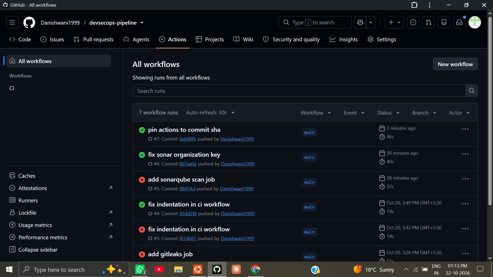

# DevSecOps CI Pipeline

[](https://github.com/Danishwani1999/devsecops-pipeline/actions/workflows/ci.yml)
[](https://sonarcloud.io/summary/overall?id=Danishwani1999_devsecops-pipeline)

A GitHub Actions pipeline that checks a containerized Flask app for leaked secrets, insecure code and vulnerable dependencies on every push and pull request. If any check fails, the build fails.

The Flask app is intentionally small. The pipeline is the project.

## Table of contents

- [Overview](#overview)
- [Pipeline architecture](#pipeline-architecture)
- [Tech stack](#tech-stack)
- [Repository structure](#repository-structure)
- [How the pipeline works (inputs and outputs)](#how-the-pipeline-works-inputs-and-outputs)
- [Security decisions](#security-decisions)
- [Proof that it works: breaking the pipeline on purpose](#proof-that-it-works-breaking-the-pipeline-on-purpose)
- [SonarQube findings and how I handled them](#sonarqube-findings-and-how-i-handled-them)
- [Troubleshooting log](#troubleshooting-log)
- [Run it locally](#run-it-locally)
- [Set it up on your own repo](#set-it-up-on-your-own-repo)
- [Known limitations and roadmap](#known-limitations-and-roadmap)
- [What I learned](#what-i-learned)
- [Author](#author)
- [License](#license)

## Overview

Most pipelines only check that code builds. This one also asks three security questions on every change:

| Question | Tool | Scans |
|---|---|---|
| Did someone commit a secret? | Gitleaks | Source code and Git history |
| Is the code itself insecure or low quality? | SonarQube Cloud | Source code (static analysis) |
| Is the container image shipping known vulnerabilities? | Trivy | OS packages and Python dependencies in the image |

The three checks run in parallel as separate jobs. A failure in any of them turns the pipeline red.



## Pipeline architecture



## Tech stack

| Area | Tool | Version / detail |
|---|---|---|
| Application | Python, Flask | Flask 3.0.3 |
| App server | Gunicorn | 22.0.0 |
| Container | Docker | Base image `python:3.12-slim` (Debian 13) |
| CI | GitHub Actions | Workflow in `.github/workflows/ci.yml` |
| Secret scanning | Gitleaks | `gitleaks/gitleaks-action` v2.3.9 |
| Code analysis (SAST) | SonarQube Cloud | `SonarSource/sonarqube-scan-action` v7.2.1, "Sonar way" quality gate |
| Image scanning | Trivy | `aquasecurity/trivy-action` v0.35.0 |

Everything used here has a free tier or is open source, and nothing requires a cloud provider account.

## Repository structure

```
devsecops-pipeline/
├── .github/
│   └── workflows/
│       └── ci.yml                 # The pipeline
├── docs/
│   └── images/                    # Screenshots used in this README
├── .dockerignore
├── .gitignore
├── Dockerfile                     # Non-root, slim image
├── LICENSE                        # MIT License
├── README.md
├── app.py                         # Minimal Flask app
├── requirements.txt               # Pinned dependencies
└── sonar-project.properties       # SonarQube Cloud configuration
```



## How the pipeline works (inputs and outputs)

The workflow runs on every push to `main` and on every pull request.

### The application

| Request | Response |
|---|---|
| `GET /` | `{"message": "DevSecOps pipeline demo"}` |
| `GET /health` | `{"status": "ok"}` |

### Job by job

| Job | Input | What it does | Output |
|---|---|---|---|
| **Gitleaks** | Full Git history (`fetch-depth: 0`) | Searches commits for secrets such as tokens and keys | Passes if no leaks. Fails with the rule, file, line and commit of each finding. Secret values are redacted in the log. |
| **SonarQube Cloud** | Source code (`sonar.sources=.`) | Static analysis, then waits for the quality gate verdict (`sonar.qualitygate.wait=true`) | Passes if the gate passes. Fails if a gate condition fails, for example Security Rating on New Code worse than A. |
| **Docker build** | `Dockerfile` and `requirements.txt` | Builds the image `devsecops-demo` | Image available to the next step. Fails if the build breaks. |
| **Trivy** | The built image | Scans OS packages and Python packages. Only HIGH and CRITICAL findings that already have a fix are reported (`ignore-unfixed: true`). | Findings table with library, CVE, installed version and fixed version. Fails the job (`exit-code: '1'`) if any are found. |

<details>
<summary>View the full workflow file</summary>

```yaml
name: CI

on:
  push:
    branches: [main]
  pull_request:

permissions:
  contents: read

jobs:
  build:
    runs-on: ubuntu-latest
    steps:
      - uses: actions/checkout@v4
      - name: Build Docker image
        run: docker build -t devsecops-demo .
      - name: Scan image with Trivy
        uses: aquasecurity/trivy-action@57a97c7e7821a5776cebc9bb87c984fa69cba8f1 # v0.35.0
        with:
          image-ref: devsecops-demo
          severity: HIGH,CRITICAL
          ignore-unfixed: true
          exit-code: '1'

  gitleaks:
    runs-on: ubuntu-latest
    steps:
      - uses: actions/checkout@v4
        with:
          fetch-depth: 0
      - uses: gitleaks/gitleaks-action@ff98106e4c7b2bc287b24eaf42907196329070c7 # v2.3.9
        env:
          GITHUB_TOKEN: ${{ secrets.GITHUB_TOKEN }}

  sonarqube:
    runs-on: ubuntu-latest
    steps:
      - uses: actions/checkout@v4
        with:
          fetch-depth: 0
      - name: SonarQube Scan
        uses: SonarSource/sonarqube-scan-action@c7ee0f9df90b7aa20e8dcf9695dcfe2e7da5b4f2 # v7.2.1
        env:
          SONAR_TOKEN: ${{ secrets.SONAR_TOKEN }}
```

</details>

### SonarQube Cloud result



## Security decisions

| Decision | Why |
|---|---|
| Third-party actions are pinned to a full commit SHA, with the version in a comment | Tags such as `@v2` can be moved to different code. A SHA cannot. SonarQube flagged this as a High security issue, and in March 2026 tags of `aquasecurity/trivy-action` were force-pushed to malicious code ([advisory](https://github.com/aquasecurity/trivy/security/advisories/GHSA-69fq-xp46-6x23)). I pinned Trivy to `v0.35.0`, the version that advisory lists as safe. |
| `permissions: contents: read` on the workflow | Least privilege. The jobs only need to read the repository, so a compromised step cannot write to it. |
| `pip install --only-binary :all:` in the Dockerfile | Installs prebuilt packages only, so no package setup script runs during the image build. |
| Container runs as a non-root user (`appuser`) | Limits the damage if the app is compromised. |
| `requirements.txt` is copied before the app code | Docker caches the dependency layer, which makes rebuilds faster. |
| Gitleaks checks out full history (`fetch-depth: 0`) | A secret that was committed and later deleted is still in history. A shallow checkout would miss it. |
| Trivy: HIGH and CRITICAL only, `ignore-unfixed: true` | The build fails only on problems that are serious and fixable, so a red build always has an action to take. |
| `sonar.qualitygate.wait=true` | Without it the scan job goes green even when SonarQube's verdict is "Quality Gate failed". With it, the verdict blocks the build. |
| `SONAR_TOKEN` is stored as a GitHub secret | Credentials never live in the repository. The Gitleaks job would catch them if they did. |

## Proof that it works: breaking the pipeline on purpose

A pipeline that has never failed has not proved anything. I triggered each security gate deliberately on a separate branch and pull request, and I did not merge either one into `main`.

### Demo 1: Gitleaks catches a leaked secret

- **Input:** branch `demo-leak` with a file `leak_test.txt` containing a made-up token in the GitHub personal access token format. It is not a real credential.
- **Output:** the `gitleaks` job failed.

```
Finding:     github_token = REDACTED
RuleID:      github-pat
Entropy:     4.734184
File:        leak_test.txt
Line:        1
...
INF 1 commits scanned.
WRN leaks found: 1
```





### Demo 2: Trivy blocks a vulnerable dependency

- **Input:** branch `demo-vuln` with `flask==3.0.3` changed to `flask==0.12.2` in `requirements.txt`.
- **Output:** the `build` job failed at the Trivy step with exit code 1.

```
Python (python-pkg)
Total: 3 (HIGH: 3, CRITICAL: 0)

Library  Vulnerability    Severity  Installed  Fixed
Flask    CVE-2018-1000656 HIGH      0.12.2     0.12.3
Flask    CVE-2019-1010083 HIGH      0.12.2     1.0
Flask    CVE-2023-30861   HIGH      0.12.2     2.3.2, 2.2.5
```





- **Fix:** I restored `flask==3.0.3` and pushed. The same pull request went green.



Both pull requests were closed without merging and their branches deleted, so `main` never contained the fake secret or the vulnerable version.

## SonarQube findings and how I handled them

The first scan reported 5 security findings, and the quality gate failed on one condition: **Security Rating on New Code was C, and the gate requires A or better.**

| # | File | Finding | Severity | Outcome |
|---|---|---|---|---|
| 1 | `ci.yml` | Use full commit SHA for this dependency | High | Fixed: action pinned to a SHA |
| 2 | `ci.yml` | Use full commit SHA for this dependency | High | Fixed: action pinned to a SHA |
| 3 | `app.py` | Make sure disabling CSRF protection is safe | High | Marked as accepted. The API has only read-only `GET` routes and no forms, cookies or sessions, so CSRF does not apply. |
| 4 | `Dockerfile` | Omitting `--only-binary :all:` can run setup scripts | Medium | Fixed: flag added |
| 5 | `Dockerfile` | Dependencies without locking resolved versions | Medium | Open. Planned: hash-locked requirements (see roadmap). |

## Troubleshooting log

Real problems I hit while building this, and what each one taught me. The run history shows the failed runs from the early mistakes and the green runs after each fix.



| Symptom | Root cause | Fix | Lesson |
|---|---|---|---|
| `build` failed with exit code 1, and `gitleaks` failed with "missing gitleaks license" | Two typos in `ci.yml`: `docker build` was missing its final `.` (the build context), and a stray `.` was appended to `${{ secrets.GITHUB_TOKEN }}`. The invalid token made the API call fail with "Bad credentials", and the Gitleaks action then fell back to asking for a license. | Corrected both lines. Gitleaks then logged that a personal account needs no license. | One typo can produce two unrelated-looking errors. Read the line above the error, and inspect the file with `grep` or `cat` before committing. |
| `git add` rejected all files | The ignore file was named `dockerignore` instead of `.dockerignore`. Git aborts the whole `git add` if one path does not exist. | Renamed the file. | Hidden files start with a dot. Use `ls -a`. |
| SonarQube: "Not authorized or organization not found" (exit code 3) | `sonar.organization` held the organization's display name instead of its key. | Copied the key from the organization page and URL. | Copy identifiers from the key field or URL, not from display names. |
| `sonarqube` job would have conflicted with Automatic Analysis | New SonarQube Cloud projects scan automatically by default. | Switched Automatic Analysis off before enabling CI-based analysis. | CI-based and automatic analysis cannot both be on. |
| Wrong commit SHA on the `actions/checkout` line | The Sonar action's SHA was pasted onto the checkout step, where it does not exist. | Caught with `grep -n "uses:"` before pushing and corrected. | Verify that each SHA belongs to the right repository. |
| YAML error reported on line 8, then line 14 | The `- name: Scan image with Trivy` step was indented less than the other steps. The parser reports the block it was reading, not the exact line. | Aligned the dash with the other steps in the list. | Look at the lines around the reported line, and check indentation with `cat -A`. |

## Run it locally

Requirements: Docker.

```bash
git clone https://github.com/Danishwani1999/devsecops-pipeline.git
cd devsecops-pipeline
docker build -t devsecops-demo .
docker run -p 5000:5000 devsecops-demo
```

In a second terminal:

```bash
curl localhost:5000/health
# {"status":"ok"}
```

Optional: run the scanners locally (requires the tools to be installed).

```bash
trivy image --severity HIGH,CRITICAL --ignore-unfixed devsecops-demo
gitleaks detect --source . -v
```

## Set it up on your own repo

1. Fork or clone this repository.
2. Sign in to [SonarQube Cloud](https://www.sonarsource.com/products/sonarcloud/signup-free) with GitHub and import the repository on the Free plan.
3. In the project, go to **Administration → Analysis Method** and turn **Automatic Analysis** off. Choose **With GitHub Actions**.
4. In GitHub, go to **Settings → Secrets and variables → Actions** and add a secret named `SONAR_TOKEN` with the token SonarQube generates. Never commit it.
5. Edit `sonar-project.properties`. Use **your** organization key and project key:

   ```properties
   sonar.organization=<your-organization-key>
   sonar.projectKey=<your-project-key>
   sonar.sources=.
   sonar.qualitygate.wait=true
   ```

6. Push to `main` or open a pull request, then check the **Actions** tab.

## Known limitations and roadmap

**Limitations**

- Gitleaks cannot post a comment on pull requests because the workflow token is read-only. The findings still appear in the job summary and the uploaded artifact.
- Dependency versions are pinned, but not yet locked with hashes (SonarQube finding #5).
- Checks are not yet enforced by branch protection, so a direct push to `main` can bypass the pull request flow.

**Roadmap**

- [ ] Lock dependencies with hashes (`pip-compile --generate-hashes`, then `pip install --require-hashes`)
- [ ] Enable branch protection so the three checks are required before merging
- [ ] Add Dependabot to keep pinned actions and dependencies up to date
- [ ] Publish the image to GitHub Container Registry after all scans pass on `main`

## What I learned

- Why a green build is not the same as a passing security gate. SonarQube's verdict only blocks the pipeline once it is told to wait for it.
- How supply-chain attacks work in practice, and why pinning third-party actions to commit SHAs matters.
- How to read scanner output: rule IDs, CVE records, installed versus fixed versions, and what `ignore-unfixed` changes.
- How to debug a pipeline by reading the logs and diffs line by line, instead of guessing.

## Author

**Danish** ([@Danishwani1999](https://github.com/Danishwani1999)), a fresher DevOps engineer building hands-on projects.

Other projects: [`k8s-gitops-observability`](https://github.com/Danishwani1999/k8s-gitops-observability), [`Advance_Log_Detector`](https://github.com/Danishwani1999/Advance_Log_Detector)

## License

Released under the [MIT License](LICENSE).
